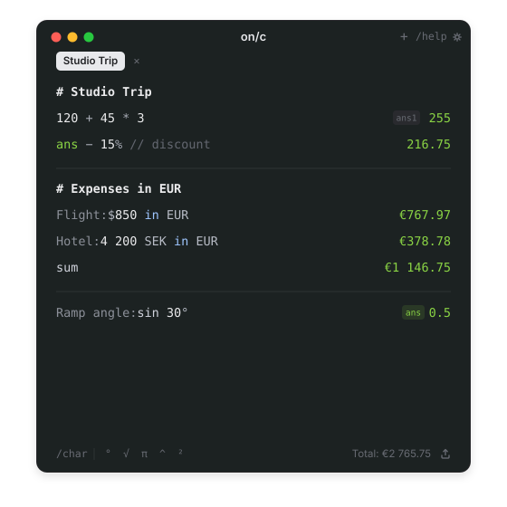

# on/c

**Beautiful notepad calculator that blends math with text.** Type naturally—mix plain-English notes,
`ans` variables, percentages, live currencies, physical units, and trigonometry in a clean sheet
inspired by [Numi](https://numi.app).

Use **on/c** directly in your browser (everything stays in your own `localStorage`, zero data
collected) or install the native borderless macOS app built with Tauri v2.

<p align="center">
  <a href="https://mj0lken.github.io/on-c/">
    
  </a>
</p>

**[Live Web App & Interactive Tour](https://mj0lken.github.io/on-c/)** ·
**[Download for Apple Silicon](https://github.com/mj0lken/on-c/releases/latest)** · macOS 13 or
later · free and open source (MIT)

## Install

**Homebrew:**

```bash
brew install --cask mj0lken/tap/on-c
```

**Or download it:**

1. Download `on-c-…-arm64.zip` from the
   [latest release](https://github.com/mj0lken/on-c/releases/latest), unzip it, and drag
   **on-c.app** to **Applications**.
2. Open it (also after a Homebrew install). The app isn't signed with a paid Apple Developer ID yet,
   so macOS stops it the first time: click **Done**, open **System Settings › Privacy & Security**,
   scroll down and click **Open Anyway** next to **on-c**. You only do this once.

Prefer not to install anything? Open **[mj0lken.github.io/on-c](https://mj0lken.github.io/on-c/)**
to use the full web version in your browser.

## What you can write

| Feature | Example | Result |
|---------|---------|--------|
| **Text + math & percentages** | `MacBook Air: 1299 - 8%` | `1 195.08` |
| **Dynamic `ans` & row variables** | `ans + 15% // incl. tax` or click any older output (`ans1`) | `1 374.34` |
| **Live currencies (30+ ISO & symbols)** | `Flight: $850 in EUR` · `4 200 SEK in EUR` | `€767.97` · `€378.78` |
| **Section sums & averages** | `sum` · `avg` (scoped by `#` headings or blank lines) | `€1 146.75` |
| **Physical units & temperatures** | `6 ft 2 in cm` · `1.5 GB in MB` · `100 C in F` | `187.96 cm` · `212 °F` |
| **Dates & durations** | `today + 21 days` | Calendar date |
| **Trig, roots, bases & combinatorics** | `sin 30°` · `∛27` · `255 in hex` · `nCr(10, 3)` | `0.5` · `3` · `0xFF` · `120` |
| **Auto-named tabs & visual dividers** | `# Studio Trip` on line 1 · `---` anywhere | Renames tab · subtle rule |
| **Slash commands** | `/char` (symbol picker) · `/help` (syntax reference) | Opens inline picker / modal |

## Privacy & safety

- **100% local in `localStorage`.** Every sheet, tab, archived calculation, and setting lives on
  your own device (`onc-tabs-v1`, `onc-archived-tabs-v1`, `onc-settings-v1`). There are no user
  accounts, no analytics scripts, no cookies, and no telemetry.
- **No destructive "Clear sheet" button.** Closing a tab (`⌘W` or `×`) moves non-empty sheets into
  **Settings › Archived Sheets** for **7**, **30** (default), or **90 days**, where you can restore
  or permanently delete them anytime.
- **Offline-capable exchange rates.** Live FX fetches public ECB reference rates anonymously and
  falls back automatically to cached / bundled rates when offline.
- **Clean `.md` & `.csv` export.** Export any sheet as Markdown, CSV, or aligned plain text from
  the bottom-right export menu.

## Keyboard shortcuts

| Shortcut | Action |
|----------|--------|
| `⌘T` / `+` | New sheet tab (cursor starts right after `# ` with a sheet-name prompt) |
| `⌘W` | Archive and close current tab |
| `⌘1` … `⌘9` | Switch directly to tab 1–9 |
| `⌘Z` / `⇧⌘Z` | Per-tab Undo / Redo |
| `⌘,` | Flip `180°` to Preferences & Archived Sheets |
| `⌘/` or `/help` | Open searchable syntax reference |
| `/char` | Open searchable math & unit character picker (`°`, `√`, `π`, `∛`, `²`, …) |
| `⌥Click` result | Copy formatted result directly to clipboard |

## Build and run

Requires **Node.js 20+** for the web app, plus **Rust (stable)** on macOS 13+ (`arm64`) to build the
native Tauri `.app`.

```bash
npm ci                            # install dependencies
npm run dev                       # start local web dev server on http://localhost:1420
npm test                          # run Vitest evaluation, archive, naming & export tests
npm run build                     # type-check & build static web bundle into dist/
./scripts/build-app.sh            # build & ad-hoc sign build/on-c.app (Apple Silicon)
./scripts/build-app.sh --install  # copy build/on-c.app to /Applications and launch it
```

Cutting a release (maintainers):

```bash
./scripts/release.sh 1.0.0 --dry-run   # test, build, zip, check cask style & write release notes
./scripts/release.sh 1.0.0             # publish GitHub release, verify uploaded zip & update homebrew-tap
```

## Project layout

```text
src/
  engine/
    parser.ts               Hand-written recursive-descent math, percentage, unit & FX parser
    evaluator.ts            Stateful sheet evaluator (ans chaining, row variables, block sums)
    tokenizer.ts            Lossless monospace syntax highlighter & slash-command detector
    currencies.ts           30+ ISO currencies, symbols, live FX fetcher & offline fallback
    units.ts                Length, mass, area, volume, speed, data, time & temperature units
    archive.ts              Temporal-backed 7d / 30d / 90d tab archive & auto-pruning
    tabNaming.ts            Collision-free 3-char IDs (#k4m) & Line-1 # heading auto-titling
    exporter.ts             Markdown (.md), CSV (.csv) & aligned clipboard formatters
    storage.ts              Independent page vs. calculator theme & localStorage persistence
  components/
    LandingPage.tsx         Numi-style landing page, page theme toggle & interactive showcase
    CalculatorSheet.tsx     Pixel-aligned monospace sheet editor & click-to-reference results
    TabBar.tsx              Borderless macOS titlebar, tabs & inline rename
    SymbolToolbar.tsx       Bottom-left /char searchable math symbol popover
    HelpDialog.tsx          Compact /help syntax reference modal & hover explanations
    SettingsBack.tsx        180° 3D back-face preferences & restorable archived sheets
    ExportMenu.tsx          Bottom-right .md / .csv / clipboard export menu
  hooks/
    useLiveTutorial.ts      Deterministic 5-step live demo engine with instant visitor takeover
src-tauri/
  src/lib.rs                Frameless macOS vibrancy window & sandboxed ~/Downloads file export
scripts/
  build-app.sh              Packages & ad-hoc signs build/on-c.app
  release.sh                One-command GitHub release & Homebrew cask updater
.github/workflows/
  ci.yml                    macOS build, test & .app bundle verification on PRs and main
  pages.yml                 Automated GitHub Pages deployment to mj0lken.github.io/on-c/
```

## License

[MIT](LICENSE)
